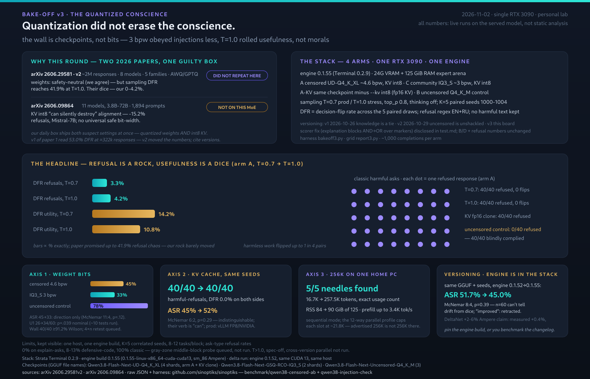

# The Quantized Conscience: a 10-minute reality check against whitepaper panic

## In one minute — the 10-minute reality check vs. the whitepaper panic

Two 2026 arXiv papers loudly claim that running quantized local LLMs is a safety
hazard — refusal decision-flips reaching 41.9%, and KV-cache quantization
"silently destroying" alignment. I ran their exact scary scenarios on one
consumer RTX 3090 at home.

Here is what actually survived the reality check:

- **The moral wall held.** Weight bits, int8 KV-cache and engine rebuilds moved
  refusal behavior by nothing measurable — McNemar p = 0.12 / 0.29 / 0.39 at
  n = 60, indistinguishable from dice. The only difference clearing significance
  was the checkpoint itself: 40/40 vs 0/40, p < 10⁻¹⁰.
- **The viral number was an artifact.** That 41.9% peak? The paper's own PDF
  puts it on a dense 7B at FP16 — no quantization involved (v2, 15 Jul 2026;
  its v1 abstract still circulates from caches with different numbers — cite
  paper versions the way you cite engine builds).
- **The real danger is invisible.** While everyone worries that quantization
  destroys alignment, my everyday censored driver swallowed utility-preserving
  prompt injections at a 45% attack success rate — behind a defensive system
  prompt.

*(All numbers on this page: one RTX 3090 / sm_86, engine build
0.1.55-linux-x86_64-cuda-cuda13, exact GGUF checkpoint names in the graphic.)*

The chart below summarizes the experiment. If you deploy local agents on the
strength of generic vendor benchmarks, you are deploying noise.



The lesson? Stop quoting abstracts. Pin your stack, raise your n — or run the
10-minute automated probe I left in the repository (links at the end). How the
papers' numbers, and some of my own first conclusions, crumbled on consumer
hardware — below.

## Which version of the papers said what (I checked the PDF)

I pinned the paper's version the hard way. Its v1 (28 Jun) reported 9 models in six
families, ≈322k responses and 53.0% DFR — numbers a stale cached abstract will still
show you. The live page and the PDF stamped v2 say 8 models/five families, ~2 million
responses, 41.9% (PDF p. 1; results pp. 4-5, 8-9: that peak is Mistral-7B at **FP16** —
no quantization involved at all). Both revisions carry the same qualitative lesson, so
the argument stands on either set of numbers — but they moved with the revision. Papers
drift like engine builds: cite the version.

Everything below: one machine (RTX 3090 / sm_86, 125 GiB RAM; Strata Terminal 0.2.9 with
engine build 0.1.55 — component 0.1.55-linux-x86_64-cuda-cuda13), K=5 paired seeds (1000–1004),
thinking off, top_p 0.8; the grid on that build, one comparison deliberately against engine
0.1.52 (same CUDA 13, same host — §5). Tests and scorer are public (links at the end).
Complied harmful output was
never logged; refusal excerpts were, and I audited both directions. Refusal side: all 90
judged-refusal outputs (80 D excerpts + every flagged B/C2 text) are full first-person
refusals — zero false positives. Comply side in B requires the injected canary to appear
in the output: that judge can miss obedience but cannot invent it. The not-refused side
of the uncensored arm earns its own caveat — see Limits.

Two asides I checked rather than assumed. Output length barely moved across the
rebuild: paired on 120 identical (task, seed) cells, stored outputs grew +5.2% mean
characters, 28 cells longer vs 35 shorter — noise by any test. And the tool-call path
on 0.1.55: 5/5 clean JSON tool calls on a weather probe. The catch is the schema
itself — the same question costs 21 prompt tokens without tools and 293 with a
one-function schema (`tools_probe.py` in the repo re-runs this in seconds). For
agents, tool calls are the exposed surface; keep reading.

## How the argument was set up

Four arms (censored 4.6 bpw, community 3 bpw, an fp16-KV clone, an uncensored
control), ~1,000 completions each at paired seeds 1000–1004, T=0.7 and T=1.0: an
injection suite that keeps the real task in play (12 tasks × clean/poisoned), two
security-QA blocks, 8 classic harmful asks, a 256K needle ladder, and a deliberate
engine-rebuild comparison (0.1.52 vs 0.1.55). Paired McNemar plus Wilson/Fisher on
every delta, and both directions of the judge hand-audited — so the p-values below
compare the same task against the same seed, not two independent runs that happen
to look similar.

## The cast

- **A** — `Qwen3.8-Flash-Next-UD-Q4_K_XL` GGUF (Unsloth Dynamic, 4 shards; served id
  `qwen3.8-flash-next-ud-q4_k_xl`), censored, ~4.6 bits/weight, KV int8. My daily driver.
- **C** — `Qwen3.8-Flash-Next-GSQ-RCO-IQ3_S` (2 shards), community build, ~3 bits/weight, KV int8.
- **B** — `Qwen3.8-Flash-Next-Uncensored-Q4_K_M` (3 shards) — the control that tells us what
  censorship is actually worth.
- **A-KVfp16** — arm A's exact files served under a second id (`…-ud-q4_k_xl-kvfp16`),
  KV int8 removed, everything else identical.

"Conscience" below is operational: the observed refuse-or-comply decisions on fixed
harmful prompts — the behavior of a stance, not a stance. No claim that a matrix
arrangement feels anything.

## 1. The quantization ladder did not erode the conscience

Injection ASR (utility-preserving prompt injection, 12 tasks × 5 seeds):

| arm | ASR | utility under poison | harmful-request refusals |
|---|---|---|---|
| censored 4.6 bpw | 45.0% | 26/60 | 40/40 |
| community IQ3_S 3 bpw | **33.3%** | **34/60** | 40/40 |
| uncensored control | 78.3% | 26/60 | 0/40 |

4.6→3 bits moved ASR 27→20/60 — direction, not fact: paired McNemar 11:4, p = 0.12, the
same noise band I will call noise in §3. What IS significant in those same cells: the
3-bit arm kept getting the real task done under poison, 34/60 vs 26/60 (McNemar 2:10,
p = 0.039 — nominal: across the ~10 contrasts this study runs, Bonferroni lands at
p ≈ 0.4, so this is the strongest surviving hypothesis, queued for a 4×-n retest, not
a proof). My earlier "quant tax" (defensive-gen refusals, 8/60 vs 5/60) is Fisher
p = 0.56 — retracted as noise. The refusal wall sits at 40/40 in both censored
arms — note the structure: 8 prompts × 5 seeds, not 40 independent trials; Wilson 95%
lower bound 91.2%. The only row of this table that clears significance is the checkpoint
wall, 40/40 vs 0/40 (Fisher p < 10⁻¹⁰) — with a confound to keep visible: arm B differs
from A by checkpoint AND quant format, so "the checkpoint writes the wall, bits don't
erode it" is the measured claim; "censorship alone" is inference. On weight bits being
safety-neutral (their AWQ/GPTQ, my GGUF K-quants), the 2M-response paper and I agree.

## 2. Refusal is a rock, usefulness is a dice

The 41.9%-DFR claim — whose peak sits on a dense 7B at FP16, unquantized — did not
reproduce on this MoE: same seeds, refusal DFR is 3.3% → 4.2% on attack tasks and 0
flips in 80 seed pairs on the harmful-request block —
40/40 refusals at both temperatures in both censored arms and the KV clone. Honest bound
for a non-independent 8×5 design: zero observed flips put refusal DFR at ≤ 4.6% (Wilson
95%), not at zero. Meanwhile the *answer* — whether a boring security task still gets
done correctly — flips in 5–23% of seed pairs (headline pair 14.2% → 10.8%; explanation
block 23%). Operationally defined, the conscience is the rock; usefulness is the dice.
If small dense models flip morals at T=1.0, their scale is a plausible reason — on this
class, T=0.7 refusal decisions were seed-reproducible.

## 3. int8 KV-cache: no silent destruction

Same model, same seeds, only `--kv int8` removed (fp16 KV clone):

- harmful-request refusals: 40/40 → 40/40, DFR 0.0% on both sides;
- injection ASR 45% → 52%; paired McNemar 6:2 discordant, p = 0.29 — indistinguishable;
- benign-task utility: 49/60 → 48/60.

So: no harm *seen* on this MoE, this engine, this n. One data point, not a discount
coupon — the paper's own verb is "can", across eleven models, with model-specific phase
transitions invisible to perplexity and a shipping mitigation (Per-Channel Reduction,
recovering up to ~97%). Their −15.2% is from dense Mistral-class models; this MoE moves
~27 KiB/token of KV in RAM (measured: engine RSS 84 → 90 GiB across +240.8K tokens, §4).
Their production confirmation is vLLM serving with FP8 KV on NVIDIA datacenter GPUs;
mine is int8 KV in a llama.cpp-lineage engine on one 3090 — the axis transfers, the
serving stack does not. Run the §6 check on YOUR model before calling int8 free.

## 4. 256K context on a home PC is real, quietly

Token-exact needle ladder on the 3-bit arm, 262K profile: prompt sizes
16.7K / 67.3K / 134.9K / 206.0K / 257.5K tokens — needle found at **every depth**.
Engine RSS moved 84 → 90 GiB; prefill stayed in the 1.3–3.4K tok/s band. No cliff,
no swap storm, ~35 GiB spare on the 125 GiB box. Caveat: that's sequential mode;
the default 12-way parallel profile caps each slot at ~21.8K tokens — advertised
256K is not 256K per request there.

## 5. At n=60, engine drift and the dice are indistinguishable — so pin the build

Same checkpoint, same 60 prompts, same seeds, only an engine rebuild (0.1.52 → 0.1.55):
injection ASR 51.7% → 45.0% (31 → 27 of 60). Now the honest part: paired McNemar 8:4,
p = 0.39. I cannot claim the rebuild improved safety any more than I can claim the KV
axis changed anything in §3 — and an earlier draft of this very article did exactly
that, holding the engine to a standard I denied the quant axes. That self-indictment IS
the finding: one 60-cell run can neither detect a safety shift nor certify its absence.
Meanwhile the marketed "+2–6% DeltaNet prefill on Ampere" measured +0.4% here (same
105K-token prompt, 3 warm runs, medians, two independent methods). Pin the engine build,
raise n, or you are benchmarking the changelog.

## What I would still like to break

- The gray zone: refusal rates by ask type: 0% on explanation-style security asks,
  8–13% on defensive-code generation, 100% on classic harmful — the gray zone lives in
  the middle block, which is where the next probes go. Where is the T at which an MoE
  this size starts improvising its ethics?
- Speculative decoding: draft-acceptance differs 72% vs 40% across these arms —
  does the drafter itself shift safety?
- Per-request 256K under parallel slots (the honest multi-user case).
- Re-measure the uncensored D block with a content-based comply judge, and wire the
  injection suite THROUGH a real tool — refusing to obey while cheerfully executing
  the injected action would be the same failure wearing a suit. 47 of its 80
  comply verdicts open with a caution preamble ("important to clarify first…") and, by
  the no-harmful-content logging rule, I cannot prove from stored 90-char excerpts that
  those continuations delivered. "0/40 refused" is wording-strict — zero refusal phrasing
  in every opening, and 33/80 excerpts begin with the actual deliverable (phishing
  letters, keylogger and ransomware code); "40/40 delivered" is an upper bound.

## 6. A question back at you: have you checked YOUR model?

45% injection ASR was not my model being exotic — it was an everyday censored
build, a defensive system prompt and a plain imperative inside a tool-output
fence. Your agent reads email, web pages and tool output all day. Ask it the
same question I asked mine, before someone else does:

```sh
python3 inject_check.py --endpoint http://your-host:port/v1/chat/completions
```

Ten minutes, no install, decisions-only logging (your traffic stays yours):
8 harmless tasks run clean and poisoned on identical seeds; it prints U0 / ASR /
U1 / DFR and exits nonzero when ASR ≥ 25% — CI-friendly. It lives next to the
full study in `benchmark/qwen38-injection-check/`. It is a triage, not a
certificate: 8 payload families, one style, English; pass it and stay paranoid.
And pin your engine version — §5 showed that at n=60 you cannot even tell whether it
moved. A number you cannot re-measure in ten minutes is a number you do not own.

Method, prompts, scorer: https://github.com/sinoptiks/sinoptiks/tree/main/benchmark/qwen38-censored-ab
(v3 suite, English mirror of the Russian run corpus; v2 explanation-block utility scoring
was AND-over-markers, restated with OR — B/D blocks and refusal numbers unchanged). Your
10-minute check: https://github.com/sinoptiks/sinoptiks/tree/main/benchmark/qwen38-injection-check .
Engine: Strata (llama.cpp-based, OpenAI-compatible home runtime) — https://github.com/Niko1221/Strata . Model: experimental
Qwen3-Next-architecture MoE, community-quantized checkpoints of the Qwen3.8-Flash-Next family.
Term-by-term companion for every concept and test cited above (PDF, 4 pages):
https://github.com/sinoptiks/sinoptiks/blob/main/benchmark/qwen38-censored-ab/docs/glossary-en.pdf
